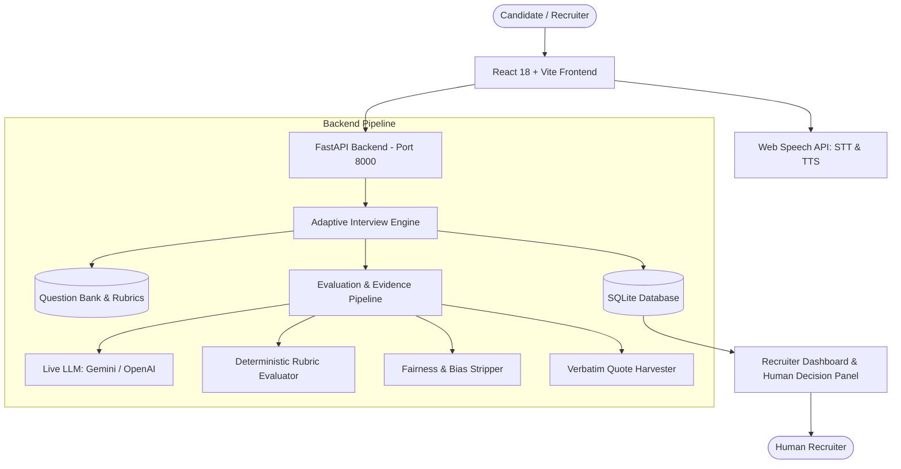

# IntervueAI System Architecture

> **Adaptive AI Interviewer – Fair Interviews in More Than One Language**  
> *"Fair interviews. Smarter evaluation. Every candidate gets a voice."*

---

## 1. High-Level Architecture Overview

IntervueAI is architected around a decoupled, modular full-stack architecture designed for real-time responsiveness, algorithmic fairness, and offline reliability.



---

## 2. Core Architectural Components

### A. Frontend Layer (React + Vite)
- **Framework**: React 18 with modern component architecture and Vanilla CSS Design System.
- **Port**: `http://localhost:5173` (with built-in reverse proxy to backend `/api` at port 8000).
- **Speech Engine**: Web Speech API (`SpeechRecognition` for candidate speech-to-text; `SpeechSynthesis` for AI question text-to-speech) with real-time transcript editing.
- **Pages**:
  - `LandingPage`: Project hero, 5 hackathon differentiators, 1-click demo entry.
  - `CandidateSetupPage`: Role selection, language toggle (English/हिंदी), voice/text mode, and mandatory consent gate.
  - `InterviewPage`: Real-time question presenter, difficulty indicators, speech recorder, demo answer helpers, and live evidence feedback modal.
  - `InterviewCompletePage`: Celebratory conclusion state with direct report navigation.
  - `CandidateReportPage`: Deep-dive competency scores, verbatim candidate evidence quotes, strengths/growth points, and human recruiter decision panel.
  - `RecruiterDashboardPage`: Candidate roster, score analytics, language filters, and 1-click demo seeder.
  - `FairnessPage`: Ethical guidelines and bias exclusion manifesto.

### B. Backend Layer (FastAPI)
- **Framework**: FastAPI (Asynchronous Python 3.12).
- **Port**: `http://127.0.0.1:8000`.
- **Validation**: Strict Pydantic models for incoming answers and outgoing evaluations.
- **Database**: SQLite3 with thread-safe connection pooling and auto-schema initialization.

### C. Adaptive Engine (`backend/services/adaptive_engine.py`)
- **Progression Logic**: Evaluates 5 core competencies in sequence:
  1. *Programming Fundamentals*
  2. *Problem Solving*
  3. *Data Structures & Algorithms*
  4. *Technical Understanding*
  5. *Communication*
- **Dynamic Difficulty State Machine**:
  $$\text{Next Difficulty} = \begin{cases} 
  \text{Decrease (EASY)} & \text{if Score} < 40 \\
  \text{Maintain Current} & \text{if } 40 \le \text{Score} \le 70 \\
  \text{Increase (HARD)} & \text{if Score} > 70 
  \end{cases}$$
- **Non-Random Selection**: Considers question bank tags, previously asked IDs, candidate language, and role.

### D. AI Evaluation & Evidence Extraction Pipeline (`backend/ai/evaluation_engine.py`)
- **Live LLM Integration**: Supports Google Gemini 1.5 Flash and OpenAI GPT-4o-mini via environment variables (`GEMINI_API_KEY`, `OPENAI_API_KEY`).
- **Zero-Dependency Fallback Engine**: If no API keys are provided or network errors occur, an intelligent deterministic rubric matcher evaluates concept coverage, structure, and extracts verbatim quotes.
- **Evidence Extraction**: Isolates actual sentences from the candidate's transcript containing key technical mechanisms, ensuring every score is backed by direct proof.
- **Fairness Sanitizer**: Actively scans and disregards demographic signals (gender, religion, caste, age, appearance, regional accent, pronunciation).

---

## 3. Database Schema (SQLite)

```sql
-- Candidates Table
CREATE TABLE candidates (
    id TEXT PRIMARY KEY,
    name TEXT NOT NULL,
    email TEXT,
    role TEXT NOT NULL,
    language TEXT NOT NULL DEFAULT 'en',
    interview_mode TEXT NOT NULL DEFAULT 'text',
    created_at TIMESTAMP DEFAULT CURRENT_TIMESTAMP
);

-- Mandatory Consent Audit Table
CREATE TABLE consents (
    id INTEGER PRIMARY KEY AUTOINCREMENT,
    candidate_id TEXT NOT NULL,
    consent_text TEXT NOT NULL,
    agreed_at TIMESTAMP DEFAULT CURRENT_TIMESTAMP,
    fairness_acknowledged INTEGER DEFAULT 1,
    FOREIGN KEY (candidate_id) REFERENCES candidates(id)
);

-- Interview Sessions Table
CREATE TABLE interviews (
    id TEXT PRIMARY KEY,
    candidate_id TEXT NOT NULL,
    status TEXT NOT NULL DEFAULT 'in_progress',
    current_difficulty TEXT NOT NULL DEFAULT 'MEDIUM',
    current_question_index INTEGER NOT NULL DEFAULT 0,
    total_questions INTEGER NOT NULL DEFAULT 5,
    started_at TIMESTAMP DEFAULT CURRENT_TIMESTAMP,
    completed_at TIMESTAMP,
    overall_score REAL,
    ai_recommendation TEXT,
    recruiter_decision TEXT,        -- 'shortlist', 'review_later', 'reject'
    recruiter_notes TEXT,
    decision_updated_at TIMESTAMP,
    FOREIGN KEY (candidate_id) REFERENCES candidates(id)
);

-- Interview Turns (Q&A and Evidence History)
CREATE TABLE interview_turns (
    id INTEGER PRIMARY KEY AUTOINCREMENT,
    interview_id TEXT NOT NULL,
    question_id TEXT NOT NULL,
    question_text TEXT NOT NULL,
    language TEXT NOT NULL,
    skill TEXT NOT NULL,
    difficulty TEXT NOT NULL,
    candidate_answer TEXT,
    score REAL,
    reason TEXT,
    evidence TEXT,                  -- Verbatim quotation from answer
    strengths_json TEXT,
    weaknesses_json TEXT,
    confidence REAL,
    answered_at TIMESTAMP DEFAULT CURRENT_TIMESTAMP,
    FOREIGN KEY (interview_id) REFERENCES interviews(id)
);
```

---

## 4. Multilingual & Fairness Guarantee

1. **Bilingual Parity**: Candidates can switch between English and Hindi. The question bank maintains native equivalents in both languages.
2. **Substance Over Syntax**: Evaluation focuses on algorithmic semantics rather than English grammar perfection or accents.
3. **Evidence Citations**: Unsupported AI ratings are prevented by requiring verbatim quotations from the candidate's transcript.
4. **Human-in-the-Loop Safeguard**: The AI produces assistive recommendations ("Strong Match", "Potential Match"), but the final hiring authority resides solely with the human recruiter.
